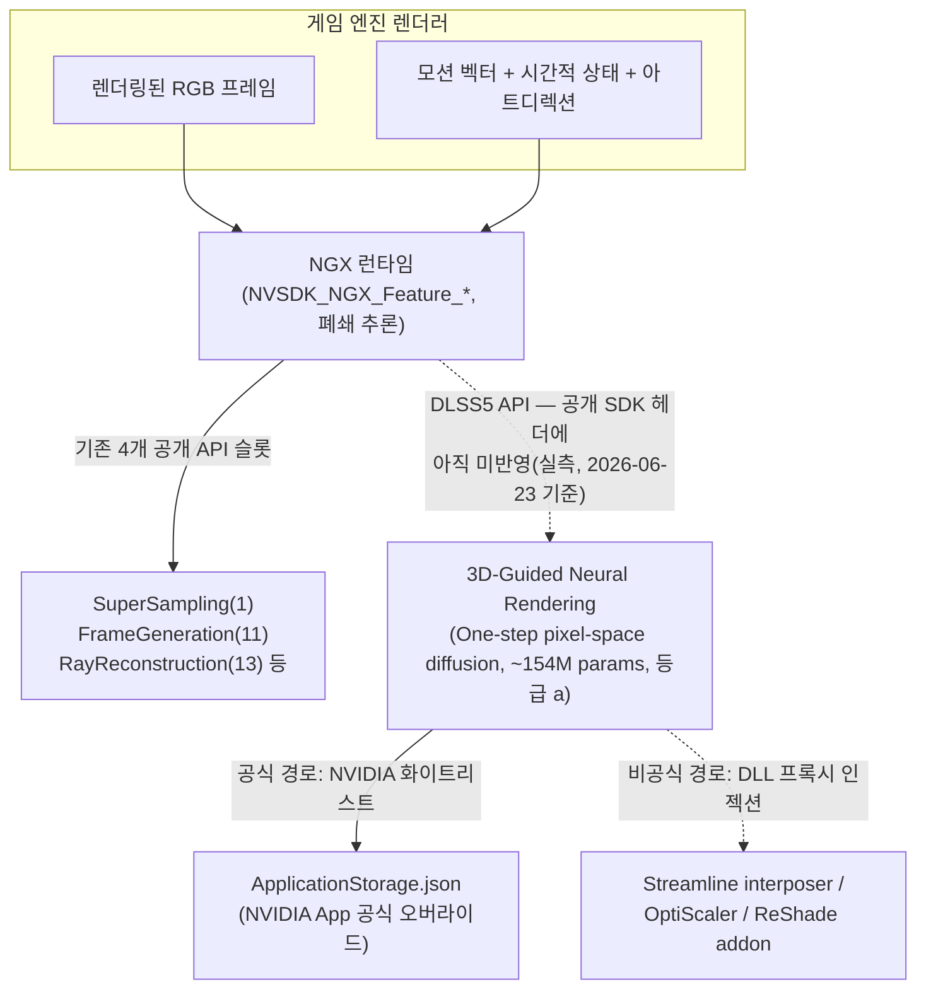

# [R] NVIDIA DLSS5 Architecture Study

NVIDIA의 차세대 업스케일링/렌더링 보정 기술 **DLSS5(3D-Guided Neural Rendering)**를
공식 SDK 저장소·NVIDIA 리서치 발표·서드파티 인젝션 도구까지 교차 확인해 분석한
학습 저장소입니다.

> **이 저장소의 방법론**: DLSS는 Streamline과 달리 신경망 구현 자체가 처음부터
> 끝까지 비공개입니다. `_source/`에 공식 `NVIDIA/DLSS` SDK를 클론했지만, 여기 있는 건
> **C++ 헤더(API 선언)와 사전컴파일된 DLL뿐**이고 모델 가중치나 학습 코드는 없습니다
> (`docs/02` 실측). 따라서 이 저장소는 (1) 공개 SDK 헤더/바이너리 직접 확인,
> (2) NVIDIA 공식 리서치 발표·기술 리포트 인용, (3) 화이트리스트/인젝션 생태계
> 조사를 결합한 방식입니다. 원본 클론(`_source/`, 약 1.5GB)은 용량 때문에 이
> 저장소에 커밋하지 않았습니다(`.gitignore`) — 재현하려면:
> ```
> git clone --recurse-submodules https://github.com/NVIDIA/DLSS.git _source
> ```
> 이 문서의 SDK 관련 분석은 커밋 `a291cc7d2cc642a51566f3dfd5376f635cd1b284`(2026-06-23)
> 기준입니다.

## 왜 이 저장소가 존재하는가

DLSS5는 2026-03-16 최초 발표, 2026-09-03 정식 출시된 최신 기술로, "업스케일링/프레임생성"
중심이던 기존 DLSS 1~4와 달리 렌더링 파이프라인 끝단에서 조명·재질을 다시 그리는
생성형 AI 단계(3D-Guided Neural Rendering)입니다. "깃허브에 있으면 뜯어보자"는
질문에서 출발했고, 조사 결과 공식 SDK 저장소에는 아직 DLSS5의 API 표면조차 반영되지
않았다는 사실(`docs/02`)과, 그 공백을 메우는 커뮤니티 인젝션 생태계(`docs/06`)까지
확인하게 되어 스터디로 확장했습니다.

## 자매 저장소

[`streamline-architecture-study`](https://github.com/willro4540/streamline-architecture-study),
[`fsr-architecture-study`](https://github.com/willro4540/fsr-architecture-study),
[`nvidia-ace-architecture-study`](https://github.com/willro4540/basic-generative-agents),
[`unity-architecture-study`](https://github.com/willro4540/unity-architecture-study),
[`reality-scan-architecture-study`](https://github.com/willro4540/reality-scan-architecture-study),
[`twinmotion-architecture-study`](https://github.com/willro4540/twinmotion-architecture-study),
[`sketchup-architecture-study`](https://github.com/willro4540/sketchup-architecture-study),
[`qgis-architecture-study`](https://github.com/willro4540/qgis-architecture-study),
[`embree-architecture-study`](https://github.com/willro4540/embree-architecture-study)와
같은 시리즈입니다. `docs/04`에서 streamline/nvidia-ace와 직접 교차검증합니다.

## 분석 대상

| 항목 | 값 |
|---|---|
| 프로젝트명 | NVIDIA DLSS5 (3D-Guided Neural Rendering) |
| 발표/출시 | 2026-03-16 발표, 2026-09-03 정식 출시 |
| 첫 지원 타이틀 | NBA 2K27 (Visual Concepts / 2K) |
| 하드웨어 요구 | GeForce RTX 50 시리즈 전용 (RTX 40 이하 미지원, 5세대 Tensor Core 타겟) |
| 공식 SDK 소스 | `github.com/NVIDIA/DLSS` (공개, 헤더+사전컴파일 라이브러리만) |
| 라이선스 | NVIDIA RTX SDKs LICENSE (독점 라이선스, 수정/재배포 제한적 허용, 소스 재사용 아님) |
| 리서치 발표 | `research.nvidia.com/labs/adlr/DLSS5/` (기술 리포트 PDF 포함) |
| 특이사항 | 공개 SDK 저장소 최신 커밋(2026-06-23) 기준 DLSS5 전용 API가 아직 반영 안 됨(실측) |

## 문서 목차

| 문서 | 내용 |
|---|---|
| [docs/01](docs/01_intro_and_history.md) | DLSS5가 뭔지, 기존 DLSS 1~4와의 성격 차이, 출시 타임라인 |
| [docs/02](docs/02_public_sdk_openness_verified.md) | 공식 GitHub SDK 실측 — 뭐가 공개돼 있고 뭐가 없는지 |
| [docs/03](docs/03_neural_rendering_architecture.md) | 3D-Guided Neural Rendering 아키텍처 (NVIDIA 리서치 발표 기반) |
| [docs/04](docs/04_crossref_with_streamline_and_ace.md) | streamline/nvidia-ace 스터디와 교차검증 — "핵심 IP는 닫고 배관만 연다" 패턴 |
| [docs/05](docs/05_applicable_design_patterns.md) | 적용 가능한 설계 패턴 결론 |
| [docs/06](docs/06_forced_recognition_and_injection.md) | 화이트리스트 인식 메커니즘 + 서드파티 강제 주입 생태계 |

## 아키텍처 한눈에 보기



> 2026-09-04 재검증: G-buffer(albedo/normal/depth/roughness/metalness) 전체가 추론
> 입력이라는 이전 다이어그램은 틀렸습니다. 실제 추론 입력은 RGB 프레임 + 모션벡터 +
> 시간적 상태 + 아트디렉션뿐이고, albedo/normal/lighting은 **학습 때만** 쓰는 감독
> 신호입니다(depth/roughness/metalness는 원문에 근거 없음). 상세는 `docs/03` §2 참고.

## 핵심 결론

DLSS5는 렌더링 파이프라인의 위치상 기존 DLSS(재구성)와 다른 새로운 카테고리(생성)이지만,
공개 전략은 이전과 동일합니다 — **핵심 신경망은 절대 공개하지 않고, 통합용 배관(API
헤더)만 공개**하는 패턴(`streamline-architecture-study`의 DLSS-G, `nvidia-ace-architecture-study`의
NVIGI에 이은 세 번째 독립 관찰 사례, `docs/04`). 다만 DLSS5는 출시 시점(2026-09-03)에
그 배관조차 공개 SDK 저장소에 아직 반영되지 않은 상태로 확인되어(실측, 등급 a), 이
시리즈에서 처음으로 "출시됐지만 공개 SDK와 동기화가 안 된" 사례를 관찰했습니다.
